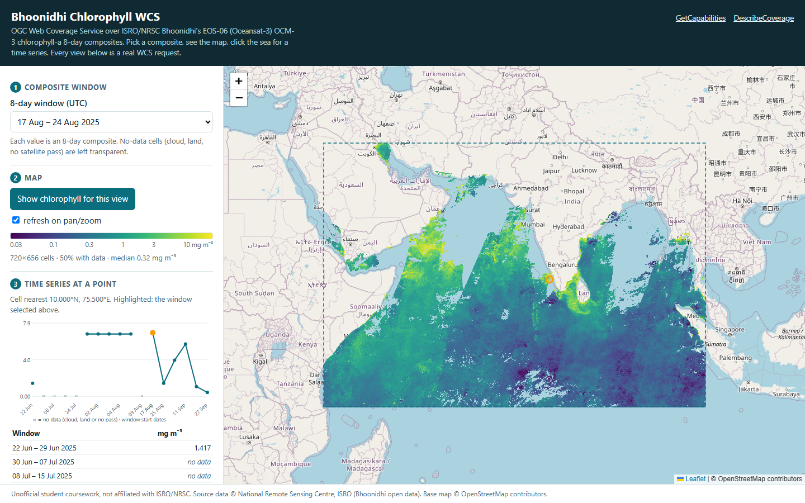

# Bhoonidhi Chlorophyll WCS

**An OGC Web Coverage Service (WCS) for ISRO/NRSC Bhoonidhi's EOS-06 (Oceansat-3) ocean-colour chlorophyll-a data.**
Request the chlorophyll values of any area, date or period over the Arabian Sea, Bay of Bengal and northern Indian Ocean with
one standard HTTP request, instead of downloading and decoding whole global files. Includes an interactive web map, a hardened
public gateway, a reproducible data pipeline, and an automated verification suite.



## Deliverables

| Deliverable | Where |
|---|---|
| **Deployed service URL** | Public: published by `python scripts/run.py --public` (see [Live service](#4-live-service)). Local: `http://127.0.0.1:8090/` |
| **README** | This file: the gap, the service design, the implementation choices, scope and future work |
| **Live demo** | The web UI at `/` and the WCS endpoint at `/geoserver/ows` accept real HTTP requests from any browser, `curl`, QGIS or GDAL |
| **Gap evidence** | [`docs/gap-evidence.md`](docs/gap-evidence.md) with a dated, reproducible probe log ([`docs/gap-probes.json`](docs/gap-probes.json)) |
| **Verification** | 114 automated tests (`pytest`) and 15 live checks against the running service (`scripts/check_live.py`) |

## Contents
1. [The problem: what a developer faces today](#1-the-problem-what-a-developer-faces-today) ·
2. [The gap](#2-the-gap) ·
3. [The service](#3-the-service) ·
4. [Live service](#4-live-service) ·
5. [Service design](#5-service-design) ·
6. [Implementation choices](#6-implementation-choices) ·
7. [Standards conformance and verification](#7-standards-conformance-and-verification) ·
8. [Run it](#8-run-it) ·
9. [Repository guide: what every file does](#9-repository-guide-what-every-file-does) ·
10. [Scope and future work](#10-scope-and-future-work) ·
11. [Data and attribution](#11-data-and-attribution)

---

## 1. The problem: what a developer faces today

[Bhoonidhi](https://bhoonidhi.nrsc.gov.in) is ISRO's national Earth-observation data hub. Among its products are the
**EOS-06 OCM-3 chlorophyll-a 8-day composites** (collection `EOS-06_OCM-GAC_Chlorophyll_8day_4km`): global, 4 km,
level-3 maps of phytoplankton concentration, the base variable for fisheries advisories, coastal water-quality monitoring and
ocean-productivity studies.

Today Bhoonidhi offers three ways in:

| Access path | What it returns |
|---|---|
| Portal (search, cart, download) | one **26 MB zip per 8-day window**, global, after login |
| [Bhoonidhi STAC API](https://bhoonidhi.nrsc.gov.in/bhoonidhi-api/) (login, JWT) | metadata and download links for whole products |
| Vista (WMS-based viewer) | rendered map images for visual browsing |

To answer *"how did chlorophyll change off the Kerala coast through the 2025 monsoon?"* a developer must:
1. log in and download every composite (17 windows = **407 MB**);
2. unzip each file and open `BAND.nc`;
3. ignore its `Time` variable, which is the constant `1` in "days since 1993-01-01" (2 January 1993), and parse the real
   period from the **file name** instead;
4. decode int16 values (`scale_factor` 0.001, fill `-32768`), rebuild the float32 coordinate axes, crop the region;
5. stack the windows into a time series and extract the cell.

## 2. The gap

**A dataset that requires manual download and would be better served via WCS.** Bhoonidhi publishes these composites only as
whole files. No Web Coverage Service exists for them, so no client can ask for *the values of an area, at a time, in a
chosen format*: the exact job WCS was standardised for.

Verified, not assumed (full method and results in [`docs/gap-evidence.md`](docs/gap-evidence.md), probe log dated
2026-10-05):

* The official API specification mentions **STAC 12 times** and **WCS, WMS, WFS, CSW, WPS, SOS, SensorThings and OGC API
  0 times**.
* `?service=WCS&request=GetCapabilities` (and WMS, CSW) on the Bhoonidhi hosts returns a generic HTML page (identical byte length
  for every service), **not** an OGC capabilities document.
* The community STAC mirror of Bhoonidhi declares 23 conformance classes (STAC, OGC API – Features, CQL2), **no coverage service**.
* Vista's client code contains WMS map requests and **no** `GetCoverage`/WCS.

**Impact.** With this service the Kerala question above is **one request** that returns a 17-band GeoTIFF of under 1 KB in
under a second, instead of 407 MB of downloads and five processing steps.

## 3. The service

**OGC WCS 2.0.1** (plus WCS 1.1.1 and 1.0.0 for older clients) serving one coverage:

| | |
|---|---|
| Coverage id | `ocean__chl` (workspace `ocean`, layer `chl`) |
| Band | `chlorophyll_a`, unit `mg m-3`, nil value `-9999` (cloud, land, no satellite pass) |
| Grid | 1441 × 961 cells, 1/24° (~4 km), EPSG:4326, 40–100 °E, 10 °S–30 °N |
| Time | 17 composite windows, 22 Jun – 4 Oct 2025; each window is a time **period** (start 00:00:00 – end 23:59:59 UTC) |
| Encodings | GeoTIFF (`image/tiff`, optional DEFLATE compression) and GML (`application/gml+xml`) |
| CRS | native EPSG:4326; output also in EPSG:3857, UTM 43N/44N (EPSG:32643/32644) and any other EPSG code via `outputcrs` |

### Operations

| Operation | What it returns |
|---|---|
| **GetCapabilities** | service identification and metadata, supported versions and conformance profiles, operations, the coverage summary |
| **DescribeCoverage** | the grid, CRS and axis labels (`Lat Long time`), the time periods, the range type (band, unit, nil value), native format |
| **GetCoverage** | the pixels, subset by **space** (`Long`, `Lat`: trim a range or slice a point), **time** (`time("t")` for one window, `time("t1","t2")` for a series: one band per window in time order), with `scalefactor`, `scalesize`, `rangesubset`, `outputcrs`, `format` |

### Example requests

Replace `$BASE` with `http://127.0.0.1:8090` (local) or the public URL.

```text
# What the service offers
$BASE/geoserver/ows?service=WCS&version=2.0.1&request=GetCapabilities
$BASE/geoserver/ows?service=WCS&version=2.0.1&request=DescribeCoverage&coverageId=ocean__chl

# Map: the sea off Kerala for the 17-24 Aug 2025 composite (48 x 48 cells, GeoTIFF)
$BASE/geoserver/ows?service=WCS&version=2.0.1&request=GetCoverage&coverageId=ocean__chl&format=image/tiff
   &subset=Long(74.5,76.5)&subset=Lat(9,11)&subset=time("2025-08-17T00:00:00.000Z")

# Time series at a point: all 17 windows at one cell, one band per window
$BASE/geoserver/ows?service=WCS&version=2.0.1&request=GetCoverage&coverageId=ocean__chl&format=image/tiff
   &subset=Long(75.5)&subset=Lat(10)&subset=time("2025-06-22T00:00:00.000Z","2025-10-04T23:59:59.000Z")

# Whole region at half resolution in Web Mercator, compressed
$BASE/geoserver/ows?service=WCS&version=2.0.1&request=GetCoverage&coverageId=ocean__chl&format=image/tiff
   &subset=time("2025-08-17T00:00:00.000Z")&scalefactor=0.5&outputcrs=http://www.opengis.net/def/crs/EPSG/0/3857
   &geotiff:compression=DEFLATE
```

Errors are standard OGC exception reports with the matching codes, for example `NoSuchCoverage`, `InvalidAxisLabel`,
`InvalidSubsetting`, `InvalidEncodingSyntax`, `InvalidParameterValue`, `OperationNotSupported`.

**Usage notes.** Give a `time` subset to choose the composite. Time ranges return one band per window, in the order listed
by `/windows.json`. With WCS 1.1.1, express the bounding box in `EPSG:4326` (lon/lat), as in
`boundingbox=74.5,9,76.5,11,EPSG:4326&gridbasecrs=EPSG:4326&gridoffsets=0.0416667,-0.0416667`.

### Web UI

Open `/` in a browser:
1. **Pick a composite window.**
2. **See the map.** The current view is fetched with `GetCoverage`, decoded in the browser (geotiff.js) and drawn with a
   logarithmic colour scale. It refreshes as you pan or zoom.
3. **Click the sea.** One `GetCoverage` time-range request returns every window at that cell, shown as a chart and a table.
4. **See the request.** Every view shows the exact WCS URL it used, with *Open*, *Download GeoTIFF* and *Copy* buttons, so
   the UI doubles as a request builder for QGIS, GDAL or scripts.

## 4. Live service

The service is published from the host machine through a secure HTTPS tunnel by one command:

```bash
python scripts/run.py --public
```

It starts GeoServer and the gateway, opens the tunnel, configures GeoServer to advertise the public address in its
capabilities links, prints the URL and saves it to `data/public_url.txt`. If the tunnel reconnects under a new address, the
script detects it and re-points everything automatically.

| | |
|---|---|
| Web UI | `https://<public-host>/` |
| WCS endpoint | `https://<public-host>/geoserver/ows?service=WCS&version=2.0.1&request=GetCapabilities` |
| Verified | 2026-10-12, at `https://4ceb5f59bebed5.lhr.life`: **15/15 live checks passed** through the public URL (all 17 windows pixel-exact, security checks included) |

## 5. Service design

```
 Bhoonidhi zips ──► ingest.py ──► data/processed/ocm_gac_chl_8day.nc  (one CF NetCDF cube, real time axis)
                                        │
                                   geotiff.py ──► data/wcs/mosaic/chl_<start>_<end>.tif  ×17  + mosaic index config
                                                        │
                    GeoServer (127.0.0.1:8080) ── ImageMosaic "ocean:chl" with a time-interval dimension ── WCS 1.0/1.1/2.0
                                                        │
 Browser / QGIS / GDAL / curl ──► gateway.py (127.0.0.1:8090): web UI · /windows.json · WCS-only allow-list
                                                        │
                                   run.py --public ──► HTTPS tunnel ──► public URL
```

* **Data pipeline** (`ingest.py`, `geotiff.py`): turns the downloaded products into one cube with a correct UTC time axis, then
  into one GeoTIFF per composite window. Values are preserved exactly (verified against the original files).
* **Coverage store**: a GeoServer **ImageMosaic** whose granules are the windows. Each granule's start and end are read from its
  file name, so the coverage has a true **time-interval** dimension.
* **GeoServer** runs from a project-local data directory, is configured entirely through its REST API by `geoserver.py`
  (workspace, store, coverage, time dimension, band description, service metadata), and listens on `127.0.0.1` only.
* **Gateway** (`gateway.py`): the only public entry point. It serves the web UI and `/windows.json`, and forwards **only WCS**
  requests (exact paths, `service=WCS`, GET/HEAD/POST, 64 KB body cap). GeoServer's administration interface, REST API and
  other services are never reachable from outside.

## 6. Implementation choices

| Choice | Reason |
|---|---|
| **WCS** | The standard for retrieving coverage values by space, time, band, CRS and format: an exact match for a gridded, time-varying product that is only available as files. |
| **GeoServer** | The OGC reference implementation of WCS 1.0/1.1/2.0, widely used in operational services. |
| **One GeoTIFF per window in an ImageMosaic** | Each composite stays an independent, inspectable granule; adding windows is adding files. |
| **Time from file names, not file metadata** | The source files' `Time` variable is a constant placeholder; the product name carries the real period. |
| **GeoPackage mosaic index** | Keeps full timestamps, so each window's end is its last second (23:59:59), not midnight. |
| **`MergeBehavior=STACK`** | A time range returns one band per window instead of a single blended image: a correct time series. |
| **Band named `chlorophyll_a`, unit `mg m-3`, nil `-9999`** | `DescribeCoverage` describes the real quantity, so any client knows what the numbers mean. |
| **Compact capabilities** | Advertising four CRSs keeps `GetCapabilities` at 7 KB (instead of 637 KB listing every known CRS). |
| **DEFLATE GeoTIFF in the UI** | Map views are ~5× smaller over the network (366 KB instead of 1.97 MB). |
| **UTC throughout** | The JVM runs with `-Duser.timezone=UTC`; all times are ISO 8601 with `Z`. |
| **Security by design** | Loopback-only GeoServer, a random admin password set on first configuration, a WCS-only gateway, request-size limits (400 MB). |
| **Reproducible configuration** | Every GeoServer setting is applied by code (`geoserver.py configure`), idempotently, with read-modify-write updates. |

### Engineering decisions informed by testing

The test suite drove several design decisions, each now guarded by a test:

| Observation | Decision |
|---|---|
| A shapefile mosaic index stores dates only (no time of day) | GeoPackage index with `java.sql.Timestamp` |
| A flat mosaic blends overlapping windows into one image | `MergeBehavior=STACK`: one band per window |
| GeoServer's default band description is generic (`GRAY_INDEX`) | explicit coverage dimension: name, unit, nil value |
| A partial REST settings update resets unspecified settings | read-modify-write for every settings update |
| A host's local timezone shifts time envelopes | JVM forced to UTC |
| Capabilities listing every CRS is large | short advertised CRS list |
| A machine-wide `PROJ_LIB` from another GIS install can shadow rasterio's | the package selects rasterio's own PROJ/GDAL data for its process |

## 7. Standards conformance and verification

The service implements the WCS 2.0.1 core operations (**GetCapabilities, DescribeCoverage, GetCoverage**) and advertises
the KVP and POST-XML protocol bindings, GeoTIFF and GML coverage encodings, and the CRS, scaling, interpolation and
range-subsetting extensions; it also serves WCS 1.1.1 and 1.0.0. Conformance
of the deployment is demonstrated by tests that boot a real GeoServer and exercise every operation:

| Area | What is verified |
|---|---|
| GetCapabilities | identification, version `2.0.1`, profiles (core, KVP, CRS, scaling), the three operations, coverage summary, compact CRS list, operation URLs |
| Version negotiation | unsupported versions negotiate to 2.0.1; 1.1.1 and 1.0.0 capabilities |
| DescribeCoverage | envelope (outer cell edges), grid size, offset vectors, **time periods = the composite windows in UTC**, band name, unit, nil value, native format |
| GetCoverage, space | trimming returns exactly the requested cells with exact values; point slicing returns one cell |
| GetCoverage, time | slices at the first second, middle and last second of every window; time ranges return one band per window in order; requests outside the data return OGC exceptions |
| GetCoverage, options | `scalefactor`, `scalesize`, `rangesubset`, `outputcrs`, GML encoding, DEFLATE GeoTIFF |
| Exceptions | `NoSuchCoverage`, `InvalidAxisLabel`, `InvalidSubsetting`, `InvalidEncodingSyntax`, `InvalidParameterValue`, `OperationNotSupported`, `NoSuchField`, with the correct HTTP status |
| WCS 1.1.1 and 1.0.0 | DescribeCoverage and GetCoverage return the same pixels as 2.0.1 |
| Data correctness | **every window at four sites equals the cube through WCS**, and the cube equals the **original Bhoonidhi files** (independent decode) |
| Deployment and security | loopback-only server, factory admin password rejected after restart, gateway refuses admin/REST/other services/other methods, request-size limits, the web UI's requests and JavaScript |

**Results:** `pytest` runs **114 tests, all green** (one is an expected-failure guard tracking a GeoServer WCS 1.1.1
axis-order behaviour). `scripts/check_live.py` runs **15 requirement checks against a live URL**: 15/15 on the public
deployment.

```bash
python -m pytest -q                                              # 114 tests
python scripts/check_live.py http://127.0.0.1:8080/geoserver      # 13 checks, local
python scripts/check_live.py https://<public-host>/geoserver --public   # 15 checks, public
```

## 8. Run it

**Requirements:** Python 3.11, Java 17+, a GeoServer **binary distribution** (tested with 2.28.5; set `GEOSERVER_HOME`,
default `~/geoserver`), and `ssh` for the public tunnel.

```bash
python -m venv .venv
.venv/Scripts/python -m pip install -e ".[test]"        # Windows   (Linux/macOS: .venv/bin/python)
.venv/Scripts/python scripts/run.py                      # web UI + WCS at http://127.0.0.1:8090/
.venv/Scripts/python scripts/run.py --public             # ... and on a public HTTPS URL
```

On the first run `run.py` builds the GeoTIFF mosaic from the committed cube, starts GeoServer and configures it (about 30 s).
`python scripts/geoserver.py stop` stops GeoServer. GeoServer's admin password is written to
`data/geoserver/geoserver-admin-password.txt` (local only).

**Adding data.** Download more `E06_OCM_GAC_<start>_<end>_8_T000000_MGG0CLHND_4km.zip` composites from Bhoonidhi into the
`Datasets/` folder (the raw downloads stay local and are not committed), then:

```bash
.venv/Scripts/python scripts/prep_data.py --raw Datasets          # rebuild the cube and the GeoTIFF mosaic
.venv/Scripts/python scripts/geoserver.py configure                # republish the coverage
```

## 9. Repository guide: what every file does

| Path | Purpose |
|---|---|
| `src/chlwcs/ingest.py` | Reads the Bhoonidhi zips: parses each window from the product name, rebuilds the exact grid, crops, stacks into a CF NetCDF cube with a real UTC time axis |
| `src/chlwcs/geotiff.py` | Writes one georeferenced GeoTIFF per window (north-up, nodata `-9999`, DEFLATE, tiled) and the ImageMosaic index configuration (time interval from the file name, GeoPackage index) |
| `src/chlwcs/geoserver.py` | Starts and stops GeoServer with a project-local data directory; configures workspace, mosaic store, coverage, time dimension, band description, WCS metadata, CRS list, limits and the public base URL over REST |
| `src/chlwcs/gateway.py` | The public entry point: serves the web UI and `/windows.json`, forwards WCS requests only |
| `src/chlwcs/web/index.html` | The web UI (Leaflet map, geotiff.js decoding, time-series chart, request viewer) |
| `src/chlwcs/__init__.py` | Selects rasterio's bundled PROJ/GDAL data for the process |
| `scripts/run.py` | One command to run everything: mosaic, GeoServer, gateway, optional self-healing public tunnel |
| `scripts/prep_data.py` | Data preparation: Bhoonidhi zips → cube → GeoTIFF mosaic, with a per-window summary |
| `scripts/geoserver.py` | GeoServer control: `start`, `configure`, `status`, `stop`, `proxy-url` |
| `scripts/check_live.py` | Requirement checks against any running deployment, comparing returned pixels with the cube |
| `scripts/probe_gap.py` | Re-runs the dated gap probes and writes `docs/gap-probes.json` |
| `scripts/inspect_product.py` | Prints the structure of a Bhoonidhi product (time variable, packing, grid) |
| `tests/test_ingest.py` | Product-name parsing, grid reconstruction, cube building |
| `tests/test_geotiff.py` | GeoTIFF georeferencing, orientation, values, nodata, metadata; mosaic index configuration |
| `tests/test_wcs.py` | WCS conformance on a freshly booted GeoServer with known pixel values (41 tests) |
| `tests/test_gateway.py` | Gateway allow-list, web UI, `/windows.json`, UI request shapes, JavaScript syntax (47 tests) |
| `tests/test_real_data.py` | The real cube against the original Bhoonidhi files |
| `tests/helpers.py`, `tests/conftest.py` | Synthetic Bhoonidhi-shaped products and the shared GeoServer fixture |
| `data/processed/ocm_gac_chl_8day.nc` | The prepared cube (17 windows, 15 MB) |
| `docs/gap-evidence.md`, `docs/gap-probes.json` | Gap evidence and the dated probe log |
| `docs/images/web-ui.png` | Screenshot of the web UI |
| `pyproject.toml`, `requirements.txt` | Package definition and pinned dependencies |

## 10. Scope and future work

* **Coverage scope.** This release publishes 17 composites (22 Jun – 4 Oct 2025) over 40–100 °E, 10 °S–30 °N. The pipeline is
  data-driven: any further EOS-06 composites placed in the input folder are published by `prep_data.py` + `configure`.
* **More EOS-06 products.** The same pipeline extends to the other OCM-3 composites on Bhoonidhi (total suspended matter,
  aerosol optical depth, NDVI) as additional coverages.
* **Encodings.** GeoTIFF and GML are served; NetCDF output can be added with GeoServer's NetCDF output extension.
* **Hosting.** The service is published through `run.py --public`; the same configuration can be deployed to a cloud host or
  container platform for a permanent address.
* **Values.** Chlorophyll values are Bhoonidhi's level-3 product, served unmodified.

## 11. Data and attribution

Source data: **EOS-06 OCM-3**, © National Remote Sensing Centre, ISRO, distributed through
[Bhoonidhi](https://bhoonidhi.nrsc.gov.in) as open data. `data/processed/ocm_gac_chl_8day.nc` is a cropped, repackaged copy
of 17 such products for reproducibility, with provenance in its `source_product` variable. This is independent coursework and
is not affiliated with ISRO/NRSC. Base map © OpenStreetMap contributors.
